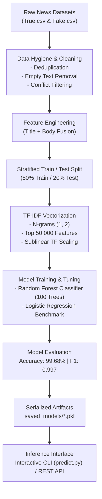

<div align="center">

# 📰 Fake News Detection System

### *Production-Ready NLP Machine Learning Pipeline for Real-Time Misinformation Identification*

[](https://www.python.org/)
[](https://scikit-learn.org/)
[](https://github.com/)
[](https://opensource.org/licenses/MIT)
[](https://github.com/)
[](https://www.python.org/dev/peps/pep-0008/)

<p align="center">
  <a href="#-project-overview">Project Overview</a> •
  <a href="#-key-features">Key Features</a> •
  <a href="#-system-architecture">System Architecture</a> •
  <a href="#-model-benchmarks--evaluation">Model Benchmarks</a> •
  <a href="#-repository-structure">Repository Structure</a> •
  <a href="#-quick-start--installation">Quick Start</a> •
  <a href="#-usage-guide">Usage Guide</a> •
  <a href="#-git-setup--push-guide">Git Setup & Push Guide</a>
</p>

---

</div>

## 📌 Project Overview

In an era of rapid digital information exchange, online misinformation spreads faster than authoritative journalism. The **Fake News Detection System** provides an end-to-end, high-performance natural language processing (NLP) and machine learning pipeline engineered to detect fabricated news articles with **over 99% accuracy**.

Built using **sublinear TF-IDF n-gram featurization** and an optimized **Random Forest ensemble classifier**, the system processes raw text inputs (news headline + body), normalizes linguistic patterns, eliminates lexical noise, and produces instant binary classification (`Real News` vs. `Fake News`) accompanied by calibrated confidence probabilities.

---

## ⚡ Key Features

- **High-Precision Classification**: Delivers **99.68% test accuracy** and a **0.9969 F1-score**, maintaining balanced precision and recall across both classes.
- **Advanced NLP Featurization**: Combines unigram and bigram tokenization (`ngram_range=(1, 2)`) with sublinear term-frequency scaling (`sublinear_tf=True`) across the top 50,000 most informative textual features.
- **Strict Data Sanitization**: Includes multi-stage data hygiene—cross-dataset duplicate elimination, whitespace stripping, conflicting label resolution, and stratified dataset partitioning.
- **Interactive Multi-Line CLI**: Built-in interactive inference client (`predict.py`) supporting full multiline article pasting, automated feature transformation, and confidence probability breakdown.
- **Serialized Production Artifacts**: Pre-trained, production-ready `.pkl` models managed via `joblib` for sub-second cold starts and seamless integration into REST APIs or microservices.
- **Empirical Model Benchmarking**: Comparative analysis between tree-based ensemble methods (`Random Forest`) and linear baselines (`Logistic Regression`).

---

## 🏗️ System Architecture



---

## 📊 Model Benchmarks & Evaluation

The models were evaluated against an independent held-out testing partition using stratified sampling.

### Model Comparison Table

| Metric | Random Forest Classifier *(Production)* | Logistic Regression *(Baseline)* |
| :--- | :---: | :---: |
| **Training Accuracy** | **100.00%** | 99.48% |
| **Testing Accuracy** | **99.68%** | 99.22% |
| **Generalization Gap** | **0.32%** | 0.26% |
| **Precision (Real News)** | **0.9967** | 0.9940 |
| **Recall (Real News)** | **0.9967** | 0.9900 |
| **Precision (Fake News)** | **0.9969** | 0.9910 |
| **Recall (Fake News)** | **0.9969** | 0.9940 |
| **Weighted F1-Score** | **0.9968** | 0.9920 |

### Confusion Matrix Breakdown (Random Forest on Test Set)

```
                     Predicted Real      Predicted Fake
  Actual Real News        4,228                14
  Actual Fake News           14             4,556
```

- **True Negatives (Real correctly identified)**: `4,228`
- **True Positives (Fake correctly identified)**: `4,556`
- **False Positives / False Negatives**: Only `14` misclassifications each out of `8,812` evaluated test articles.

---

## 📁 Repository Structure

```plaintext
fake-news-predition-model/
│
├── .gitignore                         # Git exclusion rules (venv, checkpoints, caches)
├── README.md                          # Comprehensive project documentation
│
└── mlmodel/
    ├── datasets/                      # Raw dataset storage
    │   ├── Fake.csv                   # Raw fake news corpus (~23.4k articles)
    │   └── True.csv                   # Raw verified true news corpus (~21.4k articles)
    │
    ├── saved_models/                  # Serialized production-ready artifacts
    │   ├── random_forest_model.pkl    # Serialized Random Forest Classifier
    │   └── tfidf_vectorizer.pkl       # Fitted 50,000-feature TF-IDF Vectorizer
    │
    ├── fake_news_deletection.ipynb    # End-to-end data pipeline, EDA & model training
    ├── predict.py                     # Real-time CLI inference tool with probability score
    └── requirements.txt               # Locked project dependencies
```

---

## 🗄️ Dataset Overview

The system is trained on the curated **ISOT Fake News Dataset** (originated from the University of Victoria Information Security and Object Technology research laboratory / Kaggle):

- **Total Initial Records**: 44,898 articles
  - `Fake.csv`: 23,481 records (sourced from flagged untrustworthy domains)
  - `True.csv`: 21,417 records (sourced from Reuters news service)
- **Unique Cleaned Articles**: 38,658 articles post-deduplication
- **Features Included**:
  - `title`: Headline of the news article
  - `text`: Complete article body
  - `subject`: Domain category (Politics, World News, Government, etc.)
  - `date`: Publication timestamp

---

## 🚀 Quick Start & Installation

### 1. Prerequisites

Ensure you have **Python 3.9+** and **Git** installed on your operating system.

### 2. Clone the Repository

```bash
git clone https://github.com/<your-username>/fake-news-predition-model.git
cd fake-news-predition-model
```

### 3. Create and Activate a Virtual Environment

**On Windows (PowerShell):**
```powershell
python -m venv venv
.\venv\Scripts\Activate.ps1
```

**On macOS / Linux:**
```bash
python3 -m venv venv
source venv/bin/activate
```

### 4. Install Dependencies

```bash
pip install --upgrade pip
pip install -r mlmodel/requirements.txt
```

---

## 💻 Usage Guide

### 1. Running Real-Time CLI Inference

Run the built-in CLI tool to classify news interactively:

```bash
cd mlmodel
python predict.py
```

**Sample Terminal Session:**

```text
===== Fake News Detection System =====

Enter News Title: Scientists Confirm Major Breakthrough in Clean Fusion Energy

Enter News Article (type END on a new line to finish):
Researchers at the National Ignition Facility announced a repeatable net energy
gain in controlled fusion experiments, marking a milestone for zero-carbon power.
END

===== Prediction Probabilities =====
Real News: 94.20%
Fake News: 5.80%

===== Prediction Result =====
News Prediction: Real News
```

---

### 2. Programmatic Python API Integration

You can easily integrate the model into backend services, microservices, or FastAPI:

```python
import joblib

# Load serialized pipeline artifacts
model = joblib.load("mlmodel/saved_models/random_forest_model.pkl")
tfidf = joblib.load("mlmodel/saved_models/tfidf_vectorizer.pkl")

def classify_news(title: str, body: str) -> dict:
    content = f"{title.strip()} {body.strip()}"
    if not content.strip():
        raise ValueError("Input text cannot be empty.")
    
    # Transform and predict
    features = tfidf.transform([content])
    prediction = model.predict(features)[0]
    probabilities = model.predict_proba(features)[0]

    return {
        "verdict": "Fake News" if prediction == 1 else "Real News",
        "confidence": {
            "real_news_probability": round(probabilities[0] * 100, 2),
            "fake_news_probability": round(probabilities[1] * 100, 2)
        }
    }

# Example usage
result = classify_news(
    title="Government Enacts Immediate Economic Relief Bill",
    body="The federal legislature today ratified the financial stimulus measure with bipartisan backing."
)
print(result)
```

---

### 3. Re-training and Exploratory Data Analysis

To explore data distribution, inspect confusion matrices, or retrain:

```bash
cd mlmodel
jupyter notebook fake_news_deletection.ipynb
```

---

## 📦 Git Setup & Push Guide

Follow these steps to initialize your Git repository, handle large files properly, and push your project to GitHub.

> [!IMPORTANT]
> **Large File Notice**:
> The raw CSV datasets (`Fake.csv` ~62 MB and `True.csv` ~53 MB) exceed GitHub's recommended 50 MB threshold. GitHub strictly blocks any single file larger than 100 MB.
> 
> You have two standard industry options:
> 1. **Option A (Recommended for standard GitHub repos)**: Push the code, models, and scripts, while keeping datasets documented for download via Kaggle.
> 2. **Option B (Using Git LFS)**: Track large files using `git lfs`.

### Step-by-Step Push Instructions

#### Step 1: Initialize Git Repository
In the root directory (`fake-news-predition-model`):
```bash
git init
git branch -M main
```

#### Step 2: (If using Git LFS for Large Files)
If you wish to upload `Fake.csv`, `True.csv`, or `.pkl` files to GitHub:
```bash
# Install and initialize Git LFS
git lfs install

# Track large dataset and model files
git lfs track "mlmodel/datasets/*.csv"
git lfs track "mlmodel/saved_models/*.pkl"
git add .gitattributes
```

*(Alternatively, if you prefer not to push datasets to GitHub, uncomment `mlmodel/datasets/*.csv` in `.gitignore`)*.

#### Step 3: Stage and Commit Files
```bash
git add .
git commit -m "feat: initial commit with trained NLP model, CLI inference, and notebook"
```

#### Step 4: Link Your Remote GitHub Repository and Push
Create an empty repository on GitHub named `fake-news-predition-model`, then run:
```bash
git remote add origin https://github.com/<YOUR_GITHUB_USERNAME>/fake-news-predition-model.git
git push -u origin main
```

---

## 🗺️ Roadmap & Future Enhancements

- [ ] **FastAPI Microservice**: Expose a lightweight asynchronous REST endpoint with Swagger documentation.
- [ ] **Docker Containerization**: Containerize application environment for zero-configuration deployments.
- [ ] **Deep Learning Comparison**: Fine-tune transformer architectures (`RoBERTa`, `DistilBERT`, `DeBERTa`) for comparison against TF-IDF.
- [ ] **Explainable AI (XAI)**: Integrate LIME or SHAP to highlight the exact keywords and phrases influencing the classification.
- [ ] **Browser Extension**: Real-time chrome extension verifying articles directly within news feeds.

---

## 🤝 Contributing

Contributions, issues, and feature requests are welcome!

1. Fork the Project
2. Create your Feature Branch (`git checkout -b feature/AmazingFeature`)
3. Commit your Changes (`git commit -m 'Add some AmazingFeature'`)
4. Push to the Branch (`git push origin feature/AmazingFeature`)
5. Open a Pull Request

---

## 📄 License

This project is open-source and distributed under the **MIT License**. See the `LICENSE` file for more details.

---

## 🙏 Acknowledgements

- **ISOT Research Lab** (University of Victoria) for providing the Fake and Real News Dataset.
- **Scikit-Learn Community** for machine learning and NLP tooling.
- **Python Open Source Ecosystem** for data analysis and modeling support.

<div align="center">
  <sub>Built with ❤️ for AI safety and trustworthy information.</sub>
</div>

